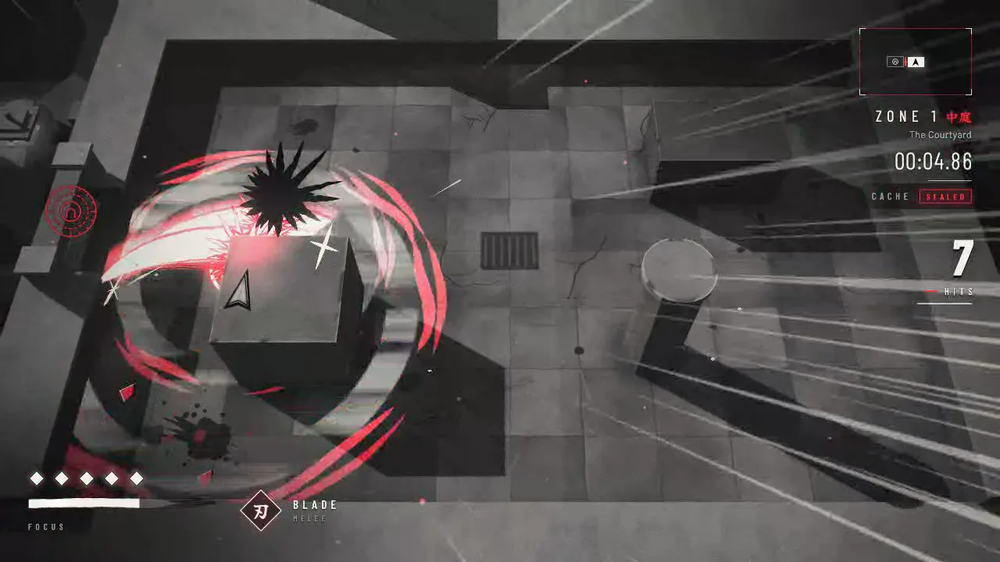

# KUZUSHI



A sakuga-styled top-down action game: a white arrowhead against geometric enemies, where every hit is drawn like a hand-animated anime moment. A run crosses three zones (The Courtyard; The Spiral, swept by the spire's beam; The Void, slabs over nothing that fall away), each a dungeon of rooms generated from the run's seed: a room's doors lock until its waves are beaten, a transition plays through every door, and each zone ends at its boss, whose gate leads to the next. Five diamonds last the whole run; springs heal, and a cleared room may leave a diamond where its last enemy fell (a side room off the way to the boss always leaves FOCUS). A dash, a parry and a finisher, KUZUSHI, come with every weapon.

Four weapons each change the attack: the blade's three cuts, the breaker's cleave and hopping slam, darts that reload on a dash and charge a piercing shot, and sigils that burst where they are cast. Each zone sends four enemies in its own accent (the Courtyard's red, the Spiral's amber, the Void's violet), elites among them, and ends at a boss with phases, a balance meter that breaks it open, and a name card: the Gatekeeper, whose charges break the pillars you hide behind; the Orrery, which becomes the spire of a sweeping beam; and Sunder, whose shifts drop the slabs around it. Each zone is its own place: a grey courtyard of walled yards under a low sun, teal-slate dials at dusk round a beam-throwing spire, blue-grey slabs over black space under a lavender light. Locked doors slam shut with an ink seal and break open when the room is won, open doors spill light with chevrons pointing out (and chevrons on the frame's edge point to those off screen), and every door plays an ink-wipe transition that holds the hero as a drawing and inks the next room in, outlines first.

The rules run in a deterministic [Ritmo](https://github.com/typeonce-dev/ritmo) simulation; [PixiJS 3D](https://pixijs.download/3d/release/docs/) draws it, [Klipp](https://github.com/pmndrs/klipp) runs the camera and GSAP animates the UI. The design is `docs/DESIGN.md`.

| | |
|---|---|
| Move | WASD / arrows |
| Aim | mouse |
| Attack (hold with darts to charge) | J / left click |
| Dash | Space / Shift |
| Parry | K / right click |
| KUZUSHI | Q / L (FOCUS full) |
| Take a weapon from an altar | E |
| Map | Tab (hold) / M |
| Pause | Esc / P |

The title's menu: START picks the zone a run starts in: zone 1 for a full run, or a later zone a run has reached on this device for practice (each card shows its place and palette, its enemies, hazard and boss, its best clear time, and on zone 1 the best full run and its rank), CONTROLS, SETTINGS (screen shake, impact flashes for photosensitive players, film grain, an FPS readout, fullscreen, the music's and sound effects' volumes; kept in the browser) and EXTRAS. Menus take W/S or the arrows, Enter and Esc, or the mouse.

**[Play it](https://goodstuff.pixijs.io/kuzushi/)**

## Running it

Requires Node 22.19+, 24 or 26+.

```sh
git clone https://github.com/pixijs/open-games
cd open-games/kuzushi
npm install
npm run dev        # http://localhost:5352
npm run check      # types, oxlint, ritmo-devtools lint, tests
npm run build      # typecheck, then build the static game to dist/, which runs from any folder
npm run preview    # serve the build on :5353
```

Screenshots need Google Chrome and `npm run dev` running in another terminal; `scripts/README.md` covers them and the ready-made step lists:

```sh
node scripts/shot.mjs --url http://localhost:5352/ --steps scripts/steps/title.json
```

The lab reviews the game in isolated scenes: open `http://localhost:5352/?lab` (or EXTRAS on the title; `?lab=special`, `attacks`, `gallery`, `threats`, `bosses`, `movement`, `zones`, `rooms`, `dungeon` or `doors` opens one directly) for the special, every weapon's moves with frame data, each zone's enemies and boss and their states, any enemy's attack or boss pattern against a stand, parry or dash, each boss in its room by phase and pattern, movement with live tuning, the zones' palettes, every room template with its doors and hazard, any seed's dungeon on a map, and the door and zone transitions frame by frame; each scene runs in any of the three zones, and the lab can pause, step and slow time and draws the hit shapes. Its keys are listed in `docs/DESIGN.md`.

`window.__game` drives the game from the console and screenshot scripts (`src/host/debug.ts`); `window.__lab` opens lab scenes and works their controls; `scripts/autopilot.js` plays a whole run for screenshot lists; `scripts/swaps.mjs` walks 30 door transitions and reports their worst frames and the heap; `window.__title.time()` is the title scene's loop clock, for shooting its beats. `docs/LAYOUT.md` says where each thing lives in `src/`; `AGENTS.md` holds the boundaries between folders and the agent skills.

## Contributing

Run `npm run check` before sending a change. Keep to the folder boundaries in `AGENTS.md` (oxlint enforces them), and keep `docs/DESIGN.md` and `docs/LAYOUT.md` in step with what you change.

## Credits and licence

KUZUSHI is released under the [MIT licence](LICENSE). Its music and sound effects are original, generated in code with Ritmo's [ritmo-tools](https://github.com/typeonce-dev/ritmo), and it plays them with [@pixi/sound](https://github.com/pixijs/sound). It animates with [GSAP](https://gsap.com), under GreenSock's [standard no-charge licence](https://gsap.com/standard-license), and sets its type in Barlow, Barlow Condensed and Yuji Boku from Google Fonts, under the SIL Open Font License.
