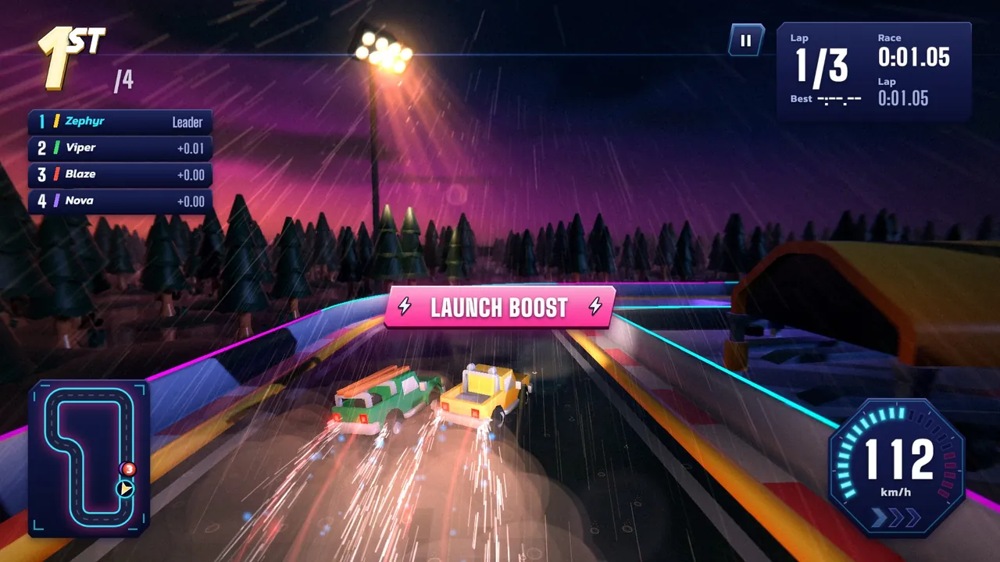

# Night Run



An online arcade truck race for up to four friends on a rain-soaked night track, built with
**[PixiJS](https://pixijs.com) 8 and [`@pixi/3d`](https://github.com/pixijs/3d)**, with
**[Colyseus](https://colyseus.io) 0.18** running the party in the host's browser. Race three bots, host a party with a
five-letter code, or draw your own track and share it as a link. Every camera is directed by
[klipp](https://www.npmjs.com/package/@pmndrs/klipp), and every piece of the 2D interface is drawn in code as SVG and
rasterised to textures at the screen's pixel ratio, up to 1.5.

**[Play it](https://goodstuff.pixijs.io/night-run/)**

Nobody runs a game server. The host's browser tab is the server, and friends reach it over WebRTC; a small
Cloudflare Worker in [`signal/`](signal/README.md) only introduces them.

## Run it

```sh
git clone https://github.com/pixijs/open-games
cd open-games/night-run
npm install
npm run dev            # the game on http://localhost:5350
```

On the dev server, parties find each other through public Nostr relays, so two tabs or two devices can race without
the Worker.

|                         |                                                                                |
| ----------------------- | ------------------------------------------------------------------------------ |
| `npm run build`         | Typechecks, then builds the static game to `dist/`, which runs from any folder |
| `npm run preview`       | Serves the build on :5351, signalling through your Worker (see below)          |
| `npm run format`        | Prettier                                                                       |
| `npm run check:scripts` | Typechecks `scripts/` against `src/`                                           |

## Checks

Night Run must keep racing exactly as it first shipped. `npx tsx scripts/bots/verify-base.ts` runs the route, the
walls and bot races (a four-bot field, and one bot alone at three paces, at 60 and 120 Hz) in Node with the game's own
physics, rules and bot, and compares every number with `scripts/bots/reference/base.json`, recorded before tracks
became data. Then it switches one physics world from Night Run to the oval and back, as the game does, and races Night
Run again against the same reference. `--codes` checks the track and line formats instead.

Custom tracks have checks of their own, all in Node:

- `npx tsx scripts/editor/doc.test.ts` runs every edit the editor makes (laying, rerouting, erasing, the start line,
  the start fix, Shuffle on 500 seeds) and its strokes.
- `npx tsx scripts/bots/run-suite.ts` races the bots on 17 check tracks, from a 68 m oval to the 899 m track that
  fills the board, and holds their lines to the competence bars; `run-reference.ts` searches the reference lines it
  measures against, and `run-calibrate.ts` checks the search on the longest tracks
  ([`scripts/bots/README.md`](scripts/bots/README.md)).
- `npx tsx scripts/venue/check-plans.ts` checks the scenery rules on the check tracks and 500 random ones
  ([`scripts/venue/README.md`](scripts/venue/README.md)).

The signalling Worker has its own install and scripts; see [`signal/README.md`](signal/README.md).

## Modes

The game opens on the title over the attract race: four bots lapping the track under a chase camera. From
the pit board you can pick:

- **Quick race**: you against three bots, straight to the grid. It runs the same room as an online party, in
  your own tab, with no network at all, and it really pauses.
- **Host a party**: your tab runs the room. You get a five-letter code (A to Z, never I or O) and an invite
  link, `?join=CODE&from=Name`. Empty seats stay open for friends until you add bots to them. You pick the
  laps (1, 2, 3 or 5), add and remove bots, remove a player, and start the race.
- **Join with a code**: type the code your host sees. An invite link lands on "Maya invited you" instead.
- **My tracks**: your tracks, and the editor to draw them in. With none yet it opens the editor on an oval.

Up to four people race, and people come before bots. Anyone past four, and anyone who arrives mid-race,
watches until a seat opens or the next race starts. After a race the podium shows the top three, and the
party goes back to the lobby when the host says so, or by itself after 20 seconds.

### Custom tracks

Besides Night Run, the game races any closed loop of road on a grid up to 14 by 9 cells, written as a short share code
such as `1gCo8` (the smallest oval). The road, walls and route come from the code alone. A custom track's scenery
follows from its route, the same for every player but the trees: grass sized to the road, floodlight towers placed
until every stretch of road is near a lamp's aim and most of it is lit as brightly as Night Run's (on packed lanes,
masts stand on the barrier between two lanes), a light tunnel over the longest straight with room beside it, TV cranes
in reach of every stretch of road, and trees round it all, drawn at random on every build, so two players' trees
differ. The set has six floodlights to give: a track with more towers than that lights the six by the road just ahead
of the truck the camera follows, each fading over as the truck goes on. Night Run keeps its own scenery, lights and
racing line.

- **The editor** draws one road on a 14 by 9 board (turned a quarter on a tall phone). There are no tools to pick:
  what a press does depends on where it lands. Drag on an empty board to lay road, drag from a glowing open end to
  extend it, and bring it back to where it began to close the loop; roads can't cross, and the board's edge stops
  them. Drag from the road out onto the grass and back onto the road to reshape it: the shorter side between the two
  goes. The start line places itself on the middle of the longest run of three or more straights, hops along when an
  edit takes its cell, and can be dragged along the road onto any cell with straights before and after it; tapping it
  lights the loop the way the race runs, and Reverse flips that. An open road's two ends pulse until you draw the loop
  closed; nothing closes it for you. Until the loop is closed and has a start, Race it, Drive alone and Share stay off
  and one line beside Race it says why ("Close the loop"); a loop with no three straights in a row gets a one-press
  fix there too. Round the board there is only back and the name (tap it to rename), Undo, Redo, Erase, Reverse,
  Share, More, Drive alone and Race it; a press that does nothing says why in a bubble on the board. More starts over
  from Night Run to remix, an oval, the board's edge, a blank board or Shuffle, and, without a touch screen, lists the
  shortcuts. Every change is saved as it's made and is one undo step, 200 deep, and the history survives a test drive
  and a reload. Start over and Shuffle replace a track only while it's still its starting point; on one you've drawn,
  they start a new track and keep that one in My tracks.
- **My tracks** keeps your tracks in this browser, one storage key each, so two tabs never overwrite each other's.
  It's a track select: tiles of each track's plan in neon, the way its author's board drew it, New track first, then
  Night Run, then yours, a page at a time (the arrows, Page Up and Down, or the mouse wheel turn them). Tapping a tile
  shows it and selects it, and Quick race and the title's backdrop follow the selection; back from the editor, the
  track just edited is the one shown (and selected once it can be raced). Beside the tiles (under them on a tall
  phone) the shown track's pit board has its plan (a small one beside its name where there's no room for a big one),
  its length, about how long a lap takes (a pace-1 bot's lap on the bots' racing line once their search has timed
  one, else at 15 m/s) and your best race on it, with Race it, Edit, Share, Duplicate and Delete (press twice). Paste
  (a link or a bare code) is in the header, and a code already in the library isn't added twice. Best races on custom
  tracks are kept by the track's code; Night Run keeps its own. The browser's Back steps back from the editor to My
  tracks and from My tracks to the title, as Esc does.
- **Sharing** copies a link to the track (or opens the share sheet on a phone): `?track=CODE&tn=NAME&from=AUTHOR&r=R`.
  Opening it lands on "Maya shared a track" over the attract race on that track, with the track's pit board as My
  tracks shows it: Race it, Edit a copy and Save keep it in My tracks "from Maya" (once it's there, Edit opens that
  one), and back is Not now.
- **In a party** the host's lobby shows the party's track with Change, which opens My tracks' tiles and pit board to
  pick from (Pick, or a second tap on the tile); guests see the same card, with Save when the track isn't in their
  library, and the results offer Save track too.
- **Bots** drive the same way on every track; only their racing line is the track's own. The host (or the player in a
  quick race) searches for it in Web Workers while nobody races: on the title, in the lobby, and in the editor, where
  a track that has stayed ready and unchanged for a second and a half waits its turn behind the one built. A track new
  to the page has its centreline at once and the best of a heuristic grid within a couple of seconds; then CMA-ES
  refines the line by racing each candidate in a headless copy of the race at three speeds and frame rates drawn
  afresh each generation, and the bots take a new line only when it beats theirs on a fixed panel of six, for
  a budget that grows with the track (about 20 s for a 110 m track on four workers, about 13 minutes for the
  largest). The search stops from a race's countdown to its results and while the page is hidden; it carries on while
  a quick race is paused, and a line it finds then waits for the race to end, so each bot races one line the whole
  race. Lines are cached in localStorage (`nightrun:lines`) by track code, with how far the search came, so it carries
  on after a reload; the tracks in My tracks keep theirs however long they go unraced, and a track the editor only
  passed through is kept once it's raced or the editor closes on it. Guests never search: bots are driven on the
  host. The workers (about 330 kB, mostly the physics) load only for a custom track, and Night Run keeps its shipped
  line and starts none. Share links carry the track alone, so a friend's page searches for its own line.

## Controls

- **Keyboard**: WASD or the arrow keys drive. **C** switches camera, **R** puts you back on the track, **V**
  watches another truck while spectating, **Esc** opens the race menu. In the menus the arrow keys move,
  Enter or Space presses, Esc goes back, and on the title 1 to 4 press a row.
- **Gamepad**: the left stick steers, the right trigger drives, the left trigger brakes then reverses. **X**
  camera, **Back** back on track, **Start** race menu. In the menus the d-pad or the stick moves, **A**
  presses, **B** goes back.
- **Touch**: a floating stick under the left thumb. On the Chase camera, which a race opens on, the stick
  steers and the throttle is automatic; pull it down to brake, then reverse. On the Diorama and Trackside
  cameras the stick points where the truck should head, at full throttle. The camera button sits under the
  right thumb, and the race menu button at the top.

Hold a slide to charge the ultra boost and straighten up to fire it. Hold the throttle on GO for a launch
boost. Laps only count when you pass every checkpoint.

### In the track editor

- **Mouse**: drag draws, extends, reshapes or moves the start line, by where it starts; click the start line to see
  which way the race runs; right-drag erases (the first stretch of road it crosses, or from an open end);
  Shift+click on grass routes from the glowing end to that cell. Hovering a control names it and its keys.
- **Keys**: the arrows move a cursor over the board (past the edge beside the buttons, they move onto the buttons),
  Space or Enter puts the pen down and lifts it. **Z** undo, **Shift+Z** redo (Ctrl or Cmd too, and Ctrl+Y), **F**
  reverses, **Shift+F** moves the start to the cursor, **G** shuffles, **M** mirrors, **Alt+arrows** move the whole
  track, **N** renames, **S** shares, **Backspace**, **Delete** or **X** erase at the cursor, **T** drives it alone,
  **R** races three bots, **?** lists them all, **Esc** cancels a stroke, closes a sheet, then goes back to My tracks.
  Keys never fire while you type a name or paste a link.
- **Touch**: one finger draws as the mouse does, a press waiting for 6 px of movement before it commits, with a
  loupe beside the finger, clear of where it's heading, showing the cells under it at twice the size. **Erase**
  lights for one stroke. A second finger landing cancels the stroke, a two-finger tap undoes and a three-finger tap
  redoes.
- **Gamepad**: the d-pad moves the cursor, **A** pen down and up, **B** back, **X** undo, **Y** redo, **Start** races
  it, **Back** drives it alone.

### URL flags

For development and test harnesses. A real player only ever opens the plain page or an invite link.

- `renderer=webgpu` draws with WebGPU; the default is WebGL.
- `resolution=N` pins the drawing buffer at N pixels per CSS pixel, from 0.75 to 1.5, and turns the resolution
  governor off; `resolution` alone pins it at the screen's own.
- `solo` (or `race`) starts a quick race at once; `host` hosts a party at once; `join=CODE` joins one.
- `name=`, `car=` (0 yellow, 1 green, 2 purple, 3 red), `laps=` (1, 2, 3 or 5), `bots=`.
- `autoready` readies a guest up in the lobby; `autostart=N` starts once N racers are seated and ready.
- `autodrive`: the bot brain drives your truck.
- `signal=local`: parties find each other among this browser's tabs, with no network. Add `unreachable`
  to make every link fail. `signal=worker` uses the Worker on the dev server too.
- `podium` shows the results over the podium at once; `debug` lets **G** show klipp's framing overlay and times the
  cameras' sight checks for `__track.occluderTime()`.
- `track=CODE` builds that track at boot instead of Night Run and selects it for this page, and `tn=` names it; a code
  that isn't a track logs a warning, says why over the title and opens on Night Run. `from=NAME` with `track` (and
  none of `solo`, `host` or `join`) lands on the shared-track card instead of the title. `r=0..3` turns the track's
  plans the way its author's board did. `editor` opens the editor at once: on `track` (the one in My tracks when it's
  there, else a copy saved from the link), else the last track edited, else a new oval. `treeSeed=N` pins the custom
  tracks' random trees.
- `botline=centre|heuristic|refined|off` caps the racing line the bots use on a custom track (`off` and `centre` start
  no worker; a capped page caches nothing), and `lineWorkers=N` sets the search's workers, 1 to 4 (by default up to 4
  on a desktop with 6 or more cores, else 1).

`window.__net`, `__race`, `__game` and `__flow` are hooks for automated tests; `src/testHooks.ts` sets them up.
`__race.resolution` reads the drawing buffer's resolution, and `__race.forceResolution(n)` sets it.
`__race.lapTimes()` gives every racer's lap times this race at full precision. Other modules add hooks of their own
with `registerTestHook` and `extendTestHook` from `src/testHooks.ts`. `src/track/hooks.ts` adds `__track`: the built
track (`code`, `name`, `lapLength`, `cells`, `turns`, `plan`), `stats()` (what the venue, the view and the renderer
hold), `load(code, name)` (switch now; false during a race or for a bad code), `validate(code)`, `random(seed)`,
`suite` (the check tracks' codes by name), `stress(n)`, which switches to the oval, the largest track and back `n`
times and returns the counts before and after, so a leak shows, `subjectScreen()` (where the camera's truck is on
screen, in CSS px), `lightTowers()` (the tower each of the six lamps is given to) and, with `?debug`, `occluderTime()`
(the cameras' time in sight checks a frame since the last call). `src/race/line/hooks.ts` adds `__lines`:
`status(code?)` (the line's stage, the candidates scored against the budget, its lap time, whether it's searching),
`wait(stage, ms)`, `offsets(code?)`, `botLines()` (each bot's lap and the line it races, by the search's count when
it was found), `askedAt()`, `workers`, `scoredAt()` and `pauses()`. `src/net/hooks.ts` adds the party's controls to
`__net`: `track` (the room's code and name), `setTrack(code, name)` (the host's pick), `setReady(ready)`,
`start(force)`, `simulateDrop(ms)` (a guest's link closes and comes back after `ms`), `dropProto()` (the next join
leaves the protocol out, as an old page would) and `failNextTrack()` (the next track the room asks for is taken for
one this page can't build). `src/ui/editor/hooks.ts` adds `__editor`: whether it's `open`, the `doc` (the path of
board cells, whether it's closed, the start line's index), its `status`, `code`, `name`, `history` (undo and redo
counts), the `reason` it can't be raced ('' once it can), `board` (whether the loupe shows, the last bubble,
refusals so far), and `cellToClient(bx, by)` and `clientToCell(x, y)` in CSS px.

## Online play

The netcode lives in `src/net/`, on [Colyseus](https://colyseus.io) 0.18 running inside the browser.

- **The room** (`RaceRoom.ts`) runs in the host's tab, or in your own for a quick race. It owns the party:
  four seats, each with its own truck colour, and spectators beyond them. It runs the flow (lobby, a
  countdown to a GO time every screen agrees on, racing, results, back to the lobby), ranks the racers and
  keeps the results. Colyseus's Node imports are swapped for browser stand-ins by `src/net/shims/plugin.ts`,
  which `vite.config.ts` loads.
- **Each screen drives its own truck** on its own physics and reports its pose 20 times a second; the
  host's tab drives the bots the same way. Other trucks are drawn 100 ms in the past, interpolated, and
  your truck bumps into stand-ins for them.
- **Finding each other**: guests reach the host through a [Trystero](https://github.com/dmotz/trystero)
  room named by the code, which passes each player's encrypted connection offer through a signalling
  service. After that, WebRTC links the browsers directly. `src/net/signal.ts` picks the service: public
  Nostr relays on the dev servers, the Worker in `signal/` in a built site, or a BroadcastChannel between
  one browser's tabs with `?signal=local`.
- **Dropping out**: a guest whose link drops keeps the seat for 20 seconds, and a reloaded page takes it
  straight back. The host leaving ends the party for everyone, with a message that says why.
- **The track**: the room's state carries the track's share code and name, Night Run's code being empty. The host's
  track is the one it opened the party on, and the room takes a change only from the host, in the lobby (the lobby's
  track card, Change, picks from My tracks), checking it with the same validator every screen uses. Every screen, the
  host's included, builds the room's track as soon as the state names it, before staging anything on it: on joining,
  on a change in the lobby (guests are told who picked what, and everyone stays ready, so the host can start straight
  away), and on coming back from a dropped link to find the room racing elsewhere, when the stale race here stops
  first. The road, walls, route and grid come from the code alone; each screen draws its own random trees. The room
  keeps its own route of the track for lap limits and distances. A guest whose page can't build the track tells the
  host, whose lobby says so, and leaves with a message; and a guest's join carries the protocol it speaks (`PROTOCOL`
  in `messages.ts`), so the room turns away a page from before tracks, which would race Night Run among players on
  another track; a later page turned away for another protocol is told to reload, and the host is told who couldn't
  join.

### The Worker's address

A built game finds its Worker at `DEPLOYED_SIGNAL_URL`, near the top of `src/net/signal.ts`, or at
`VITE_NIGHTRUN_SIGNAL_URL` when the build sets it:

```ts
const DEPLOYED_SIGNAL_URL = '';
```

It ships empty, so a build of this repository has no online races: quick races, the editor and shared tracks work as
usual, and Host and Join say "Online races aren't set up on this site." To race online from your own site, deploy
the Worker in [`signal/`](signal/README.md) to your Cloudflare account with your site's origin in `ALLOWED_ORIGINS`,
and put its URL here. The dev server needs none of this: it signals through public Nostr relays.

## How it fits together

The game and the interface meet at one seam, `src/ui/contract.ts`: the game tells the UI what to show as
data, and the UI tells the game what the player chose through the `UiActions` it was made with.
`src/main.ts` builds everything and is the one place the UI is made.

- `Flow.ts`: the flow between screens and the bridge to the room.
- `Game.ts`, `Race.ts`, `Racer.ts`: the world's phases, the trucks on one physics world, and the frame loop.
- `Vehicle.ts`, `TruckModel.ts`, `Physics.ts`, `DriftBoost.ts`: driving, the drawn truck, the
  [crashcat](https://github.com/isaac-mason/crashcat) world and drift charging.
- `Venue.ts`: the world a track is raced in, one for the page. Switching tracks (`Game.setTrack`, only while nobody
  drives) tears the last track's pieces, walls, occluders and set down and builds the next in the same frame; the
  ground, the set's nine lights, the physics world and the cameras stay, and the rain's road mask is a uniform, so a
  switch compiles no shader. `Track.ts` places a venue's road pieces and scenery from its plan.
- `CameraRig.ts`, `StageCameras.ts`, `KlippPixi.ts` and the files beside them: the race and staging cameras.
  The title's attract shot rides a `ChaseBody` of its own.
- `track/`: tracks as data, all pure. `code.ts` writes a track as one turn letter per grid cell from the finish
  (`S`, `L`, `R`), packs it into a share code and holds the one validator; `base.ts` is Night Run's curated venue,
  kept as it shipped; `pieces.ts` turns cells into kit pieces and wall colliders; `plan.ts` gives Night Run its curated
  venue and any other track one from rules on its route; `generate.ts` makes random tracks. `doc.ts` is the editor's
  document, one path of board cells, and every edit made to it (laying, rerouting, erasing, the start line, the
  start fix); `library.ts` is My tracks, the selection and best races, over local storage.
- `race/`: the pure race rules, the route (a `Route` built from a track's cells) and the bot brain, which the room
  runs too. `race/course.ts` is the track being raced, one object every part reads the route and racing line from;
  `race/line/` holds racing lines, the service the game asks for them, and their search: `sim.ts` (a headless race on
  the game's own physics and bot), `heuristic.ts`, `cma.ts`, `search.ts`, and the workers it runs on (`pool.ts`,
  `lineWorker.ts`).
- `look/`: the night look (sky, lens, wet track, floodlights, neon, the logos on the arch, truck lights, rain and
  fireworks); `look/set/LampPool.ts` hands the set's six floodlights to the towers nearest the action on a track
  with more.
- `ResolutionGovernor.ts`: dynamic resolution, which `main.ts` runs every frame. The canvas starts at the screen's
  pixel ratio, up to 1.5, and steps down, as far as 0.75, when frames run slower than 60 a second, then back up when
  they keep pace. Only the drawing buffer moves: the UI keeps its art and text at the screen's ratio, and bloom and
  the headlight beams, which turn off or cheapen on small screens, judge by the screen's ratio too.
- `music/`: the title and race tracks, synthesised live. `ui/sfx.ts`: the UI sounds, synthesised.
- `ui/`: the screens, the HUD, the UI kit and all the SVG art. `ui/editor/` is the track editor: the board, its
  strokes, undo and the editor screen; `ui/screens/TracksScreen.ts` is My tracks and the host's track picker, and
  `TrackLinkScreen.ts` a shared track's landing.
- `boot.ts`: fades the loading screen out once the title is up, or shows why the race can't start.

## The art and audio

The trucks, track pieces and scenery are Kenney's glTF models, and the engine, skid and impact sounds are
Kenney's too, all in `public/racing/`. Each sound ships twice: as Ogg Vorbis, and as AAC in `.m4a` for
iPhones before iOS 18.4, which can't decode Ogg. The game loads the Ogg wherever the browser can play it,
because Chrome and Firefox pad an AAC file with silence, which would break the engine and skid loops. The
`.m4a` files were encoded with macOS's `afconvert -f m4af -d aac -b 128000`, which records the encoder delay,
so Safari loops them without a gap. Everything else is made in code: the UI art is SVG built at run time,
and the music and UI sounds are synthesised with WebAudio. The two UI fonts, Big Shoulders Display and
Kanit, ship as latin `woff2` files in `public/fonts/` with their licenses; `fonts.css` there declares them,
`index.html` links it, and the UI waits for the faces before it draws text.

Colyseus × PixiJS stands on a truss on top of the finish arch: the two logos as 3D models, `colyseus-logo.glb` and
`pixijs-logo.glb` in `public/racing/`, with a neon × between them. There's one copy, and it turns to face whichever
side of the line the camera is on. The models are packed with meshopt (welded, quantised and without their unused
UVs), from 6.3 MB to 0.5 MB, and `@pixi/3d` decodes them as they load. The loading screen, the title and the party
lobby show the same row as SVG, `src/ui/art/collab.svg`, drawn from the logos' own paths: Colyseus's from
`media/logo.svg` in its repository, and PixiJS's from its wordmark.

`screenshot.webp` is a frame of the game itself, a quick race just after GO.

## Deploying

`npm run build` writes a static site to `dist/`. The Vite base is relative, so it runs from any folder on any static
host. Online races also need your own signalling Worker, deployed to Cloudflare by hand, apart from the site (see
[The Worker's address](#the-workers-address)).

The game chunk is about 1.5 MB (465 kB gzipped). The room and the online code (Colyseus and Trystero, about
340 kB) load only once you pick a mode on the title, or open My tracks or the editor, where a race is a press away.
The bots' line search is a worker chunk of its own, about 330 kB. Vite warns about the game chunk's size. The meshopt
decoder (26 kB) loads with the logo models.

## `@pixi/3d`

`@pixi/3d` 0.1.0 and `pixi.js` 8.23.0 come from npm, pinned exactly.

Every post effect in the night look runs at the `'afterToneMapping'` stage. The look was graded on the picture
as it shows, and a `'beforeToneMapping'` effect would switch the view to linear light with the tone curve
applied once at the end, which shifts the sky, the wet road and the grade.

The glowing unlit art (neon, lamps, beams, flames, rain, spray and fireworks) stays off the view's ACES curve,
through `skipToneCurve` in `src/look/toneCurve.ts`. 0.1.0 puts every material on the curve and dropped the public
per-material opt-out, and under ACES no input colour reaches the neon cyan the game was graded with, so the helper
sets the engine's internal `_skipsToneCurve`. Check that it still exists after updating `@pixi/3d`. The tyre marks
are rubber, not light, so they stay on the curve.

## Credits

The trucks, track and scenery models and the engine, skid and impact sounds are from
[Kenney's Starter Kit Racing](https://github.com/KenneyNL/Starter-Kit-Racing): the assets are
[CC0](https://kenney.nl/), the kit is MIT. The game began as a Pixi 3D port of
[mrdoob's three.js Starter-Kit-Racing](https://github.com/mrdoob/Starter-Kit-Racing) (MIT), and its netcode
follows the shape of [endel's Multiplayer-Starter-Kit-Racing](https://github.com/endel/Multiplayer-Starter-Kit-Racing)
(MIT). The Colyseus and PixiJS logos belong to their projects and mark the collaboration. The music, the UI sounds
and the interface art are original, generated by the source in this folder. The starter kit's MIT
license ships in `public/licenses/starter-kit-racing.txt`. Big Shoulders Display and Kanit are licensed under the SIL
Open Font License; their licenses ship in `public/fonts/`.

The game's source is MIT licensed; see [`LICENSE`](LICENSE).
