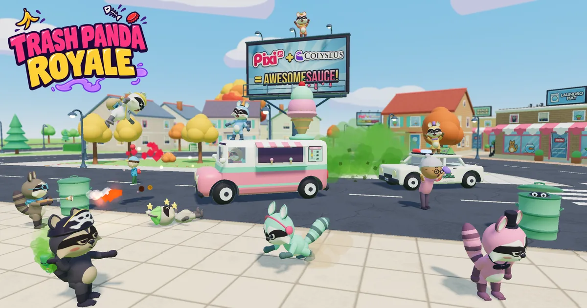

# Trash Panda Royale



A multiplayer battle royale for chibi raccoons in a toy town, built as a demo of **[PixiJS](https://pixijs.com) 8 with `@pixi/3d`** and **[Colyseus](https://colyseus.io) 0.18**. Steal cars, surf trains, dig weapons out of trash cans or hide in one, scurry through the sewer under the streets, fight over the golden dumpster the garbage truck brings on Garbage Day, and be the last raccoon standing while the fumigation gas closes in. Knocked out? You come back as a seagull: poop on the living and snatch their loot.

**[Play it](https://pixijs.io/open-games/trash-panda-royale)**: that page is the static client (`npm run build`), playing on a Colyseus server at demos.colyseus.cloud.

## Run it

```bash
git clone https://github.com/pixijs/open-games
cd open-games/trash-panda-royale
npm install
npm start          # Vite and the Colyseus server on one port: http://localhost:5173
```

Open two tabs: a round starts once two raccoons are in. Playing alone? `npm run bots` adds five bots that play the round.

| | |
|---|---|
| `npm test` | Room integration tests (`@colyseus/testing`), tests of the shared step, asset checks |
| `npm run bots` | Bots that play through real clients (`-- --bots 8 --skill 0.7`) |
| `npm run build` | Builds the static client into `dist/`, playing on the server `VITE_SERVER_URL` in `.env.client` names |
| `npm run build:full` | Builds the client into `dist/client` and the server into `dist/server` |
| `npm run start:prod` | Serves both from http://localhost:2567 (after `build:full`) |
| `npm run assets` | Rebuilds every model, texture map and icon with Blender 5.2 (`$BLENDER` sets its path), then compresses the models |

URL options: `?renderer=webgpu` (WebGL is the default), `?fx=low` (no post effects, cheaper shadows), `?netdebug=1` (the Colyseus SDK's debug panel, with a latency and jitter simulator), `?gallery=1` (every model, look and animation on one screen).

**Controls:** WASD to move or drive · mouse to aim, click to shoot · Space to jump (jump into a car, a train or a ledge to climb onto it) · Shift to sprint · E to steal a car, hide in a trash can or go down a manhole · hold G to wind up a stink bomb · 1–4 for weapons · C to switch camera · T to taunt · F1 for the full list. As a seagull: click to poop, E to snatch loot, Space and Shift to climb and dive, V to watch instead. A gamepad works too, in a GTA V layout.

## Colyseus 0.18

The server is authoritative. Everything the client predicts goes through one deterministic function, `stepPlayer` in `src/shared/sim.ts`. The server runs it once per input; the client runs it to predict and again to replay unacknowledged inputs. The server is set up in `src/app.config.ts` (`defineServer`, `defineRoom`), and the `colyseus/vite` plugin runs it inside Vite's dev server.

**State and input** (`src/shared/schema.ts`)
- The state and the input are declared once with `schema()` and `t`, and both sides import them.
- `defineInput(PlayerInput, { sanitize })` clamps every decoded input and makes it NaN-safe before the step reads it.
- `setFixedTimestep(step, 30)` runs the room at 30 Hz, one buffered input per player per step.

**Client prediction** (`src/client/Game.ts`)
- `Predict.get(room, { mode: "lerp", delay: 100 })` draws other raccoons and cars 100 ms in the past.
- `predict.reconciler()` predicts your own raccoon with the shared step (walking, driving, riding a car's roof), then rolls back and replays on a correction.
- `attachAll("npcs", { mode: "reckon" })` dead-reckons the townsfolk.
- `ctx.memo()` freezes what the step saw of the cars on screen, so a replay gets the same answer.
- `predict.defineEvent()` shows hit markers, loot pickups (a gull's snatches too), run-overs and knocked-over lamp posts at once. The server then confirms them or rolls them back.
- `predict.spawns("grenades")` puts your stink bomb in the air the moment you let go. It's paired with the server's grenade by the seq of that input.

**Lag compensation** (`src/server/GameRoom.ts`, `src/server/Combat.ts`)
- `allowRewindState()` records players and cars on the snapshot timeline, and townsfolk on the reckon timeline.
- `rewind.lastSeenBy(shooter)` judges each shot and slap against where the shooter saw its target. This includes raccoons riding on a moving car or train.

**Shared clock** (`src/shared/train.ts`)
- Trains are a pure function of `room.clock`. Clients draw them at `clock.renderNow()`. The predicted step evaluates them at each input's `reckonTime`, which the server reads back.
- So boarding a moving train and getting flattened by one are predicted exactly, and trains cost zero bandwidth.

**One message, every screen** (`src/server/Gulls.ts`, `src/client/world/DropsView.ts`)
- A gull's dropping is a 7-number `poop` message: where it left and how fast. Everyone watching falls it with the same `stepDrop`, so it lands in the same spot on every screen. Only a hit on a raccoon (`pooped`) is the server's word.

**No message at all** (`src/client/world/KnockView.ts`)
- Cars in the shared step drive through hydrants, benches, trash bags and trash cans. Each screen knocks them flying as the cars it draws hit them, and stands them back up 10 s later. None of it is synced.

**Interest management** (`src/server/Interest.ts`)
- `players`, `cars`, `npcs` and `grenades` are `.view()` collections. Each client's `StateView` gets what's within 64 m and drops what's beyond 80 m.
- A raccoon hiding in a trash can, or scurrying through the sewer, is in nobody's view but its own, so where it is never leaves the server. Only the manholes it passes under rattle (`src/server/Sewers.ts`).
- A gull out of the round gets its own surroundings, like a raccoon still in it, not whoever it was watching.
- `.view(OWNER)` fields reach only their owner. One of them, `aoi`, tells your client whose surroundings it's being sent, and the minimap draws that as rings.

**Rooms and tooling**
- `onDrop` with `allowReconnection(client, 20)`: a dropped raccoon stays in the round and picks up where it was.
- `/monitor` and `/playground` are mounted in development.
- `@colyseus/testing` drives the integration tests in `test/`, `@colyseus/loadtest` runs the bots in `loadtest/`, and `@colyseus/sdk/debug` is the `?netdebug=1` panel.

## PixiJS 8 and @pixi/3d

The whole game is one PixiJS `Application`: a `View3D` for the town, with the 2D HUD on the same stage on top of it.

**Rendering** (`src/client/Game.ts`)
- `View3D` with ACES tone mapping, linear fog, a hemisphere `environment` light and a cube-map sky. The sky is painted on a canvas at load and turned into a `CubeTexture` (`gfx/Sky.ts`).
- A `DirectionalLight` sun casts 3 shadow cascades with 9-tap PCF filtering.
- `TiltShiftEffect` and `BloomEffect` from `@pixi/3d/extras` give the toy-town look. The tilt-shift focus and the fog follow the camera.

**Models and meshes**
- The glTF models are baked by the Blender scripts in `assets-src/blender/`. `Assets.load` loads them and `Model3D` instances them, sharing geometry and recolouring materials per instance (`assets.ts`).
- The models are meshopt-compressed (`EXT_meshopt_compression`, `assets-src/compress-models.mjs`): 5.1 MB of GLBs ship as 1.8 MB, and `@pixi/3d` decodes them as they load.
- `ParticleSystem3D` makes the fire, smoke, sparks, confetti, dust and stink clouds (`Fx.ts`). `PointLight`s flash with each shot and blast, and glow at the level crossings.
- Custom `Geometry3D` meshes draw skid marks, decals, the fumes' wall and the stink bomb's aim arc (`world/SkidMarks.ts`, `gfx/Decals.ts`, `gfx/Band.ts`).
- `BatchedMesh3D` keeps the shadows of buildings that fade out of the camera's way (`world/CityView.ts`).
- The billboards' "PixiJS + Colyseus = AWESOMESAUCE!" poster is painted from the two logos' SVGs at load (`gfx/Billboard.ts`).
- `Ray` and `Plane` turn the mouse into a point on the ground for the overhead camera (`CameraRig.ts`).

**2D on top** (`src/client/Hud.ts`)
- The minimap, the health and stink-bomb meters, the kill feed, name tags and the gamepad glyphs are PixiJS `Container`, `Graphics`, `Text` and `Sprite`. They're drawn over the `View3D`.

## Layout

```
src/app.config.ts  the Colyseus server: rooms, /monitor, /playground
src/shared/        the deterministic step (sim.ts), schema, the town's map and generator, the sewer, trains, the fumes, shared hitscan
src/server/        GameRoom (input, rewind, step), BattleRoyale, Interest (StateView), Bins, Sewers, Gulls, Loot, GarbageDay, Combat, Traffic, Pedestrians
src/client/        Game (netcode wiring and the frame loop), views, world, anim, Fx, Hud, Sfx, Controls
assets-src/        Blender scripts for the models, textures and icons; the model compressor and checks
test/, loadtest/   integration tests, bots
```

## Notes

- `@pixi/3d` is in open beta (0.1.0). The game works around shadows that scramble on Intel GPUs under Direct3D 11 (`gfx/instanceIndexUpload.ts`; `?indexfix=0` turns the fix off).
- It's desktop only: keyboard and mouse, or a gamepad. There are no touch controls.
- From the default camera, behind the raccoon, you can see past the 64–80 m the `StateView` sends. So cars and people pop in about 64 m away.

## How it was made

The game began as *Tiny Town Mayhem*, a mini-GTA that Claude Code (Claude Opus 5.5) generated from a single prompt on 2026-10-12. Later sessions turned it into Trash Panda Royale over 26 polish passes.

## License

[MIT](LICENSE).
